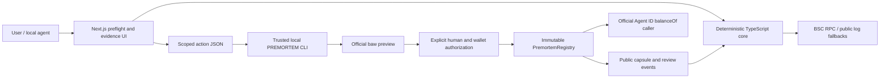

# PREMORTEM

**LET THE FUTURE FAIL BEFORE IT HAPPENS.** Proof before action.

Agent ID-native, deterministic preflight and adversarial review for consequential on-chain proposals. PREMORTEM records advisory decisions; it never executes the proposed transaction, takes custody, or grants token approvals.

Public source: [eshaanvgupta/premortem](https://github.com/eshaanvgupta/premortem). See [executed validation](docs/VALIDATION.md) and [deployment readiness](docs/DEPLOYMENT_READINESS.md) before launching.

## Run locally

Requires Node.js 22+ (validated with 24.16), pnpm 11.25, and an internet connection for real BSC reads. Foundry and Solidity 0.8.39 are needed for contract tests. No database, proprietary model, API key or backend service is required.

```sh
pnpm install --frozen-lockfile
pnpm dev
# http://127.0.0.1:3000
```

On Windows when PowerShell blocks npm shims, use `pnpm.cmd`. Read-only preflight works immediately. Protocol history correctly reports **awaiting deployment** until a genuine registry address, deployment block and verified runtime hash are configured. There are no production mock records.

Put public frontend configuration in `apps/web/.env.local`, using [.env.example](.env.example). Next reads environment files from the web app directory, not the repository root. Public values are embedded at build time. Local CLI configuration uses your own shell environment. Never put signing keys or wallet sessions in website environment variables.

## Verify the implementation

```sh
pnpm lint
pnpm typecheck
pnpm test
pnpm test:contracts
pnpm test:anvil
pnpm build
pnpm exec playwright install chromium
pnpm test:e2e
pnpm test:protocol
pnpm lighthouse
pnpm secret:scan
pnpm audit --prod
pnpm prepare:mainnet
pnpm release
```

`test:protocol` builds a separate `.next-protocol` application and runs real browser review workflows against an isolated ephemeral Anvil EVM. Identity runtime/storage are injected by a **test-only harness**; there are no deployment transactions. Synthetic identities and records never enter production configuration. `prepare:mainnet` runs tests and real **read-only** network checks, then writes a Standard JSON verification/deployment package. It does not sign or broadcast. The Foundry wrapper supports native tools and this Windows host's Ubuntu-24.04 WSL installation.

For direct Foundry use:

```sh
cd packages/contracts
forge test -vvv
forge test --gas-report
forge fmt --check
```

## Application

| Route         | Working purpose                                                                                      |
| ------------- | ---------------------------------------------------------------------------------------------------- |
| `/`           | The Rift, product narrative and chain-derived status                                                 |
| `/lab`        | Exact-input RPC observation, deterministic findings, Future Tree, manifest and capsule preparation   |
| `/arena`      | Paginated, searchable real on-chain capsules and phase filters                                       |
| `/arena/:id`  | Open/blind review, counterevidence, manifest integrity check, finalization, validated receipt export |
| `/recorder`   | Chain timeline and independent transaction/receipt verification                                      |
| `/me`         | Official `balanceOf` identity check and public contribution history                                  |
| `/proof`      | Confirmed, deduplicated holder participation with explicit scan coverage                             |
| `/security`   | Trust boundaries and official local wallet setup                                                     |
| `/developers` | SDK, ABI and CLI integration                                                                         |
| `/submission` | Honest judges dossier and launch requirements                                                        |

The frontend supports an actual installed EIP-1193 browser provider. It does **not** represent that as an Agentic Wallet connector. Agentic Wallet users download a scoped JSON action and execute it only in their trusted local environment through the official `baw` CLI adapter. There is no website QR sign-in, pairing-code field, server custody or wallet session storage.

```sh
pnpm premortem doctor --from YOUR_PUBLIC_AGENTIC_WALLET_ADDRESS
pnpm premortem inspect --from YOUR_PUBLIC_ADDRESS --to TARGET --data 0x --value 0
pnpm premortem capsule prepare --file premortem-action.json
# Signing command: only run when you intentionally authorize this exact mainnet call.
pnpm premortem execute --file premortem-action.json
```

The adapter enforces unexpired Developer Mode, official preview, preview consistency checks and an interactive human confirmation. Unsupported official response schemas fail closed. Real Agentic Wallet signing remains unverified until an actual consenting holder exercises its custom-call preview and execution.

## Architecture



- `apps/web`: responsive Next.js App Router UI, self-hosted OFL fonts, local preferences, bounded checkpointed public event scans and optional consent-based local AI explanation.
- `packages/core`: canonical hashes, selector decoder, deterministic rules, chain client, reorg-aware event ingestion, manifest and receipt verification.
- `packages/contracts`: immutable Solidity registry, Foundry unit/fuzz/invariant tests, gas/static-analysis evidence, verification inputs.
- `packages/cli`: strict action files and official local wallet adapter; no credential storage.
- `packages/agent-skill`: instructions for your trusted local agent runtime. This is an independent project skill, not an official Binance skill.
- `scripts`, `tests`, `.github`: local validation, read-only deployment readiness, browser workflows, deterministic release archive and CI.
- `docs`: threat model, user/deployment/API guides, limits, submission, adoption and demo/pitch material.

## Deployment boundary

**No PREMORTEM contract has been deployed and no public site has been published by this build.** Mainnet chain ID is 56. The official identity registry is `0x60b9262456de011f7d15a54cdd8c48baaa8b022f`. The PREMORTEM mainnet address remains unknown until an explicitly authorized deployment.

See [deployment instructions](docs/VERIFY_DEPLOYMENT.md), [readiness evidence](docs/DEPLOYMENT_READINESS.md), [validation report](docs/VALIDATION.md), [security model](docs/SECURITY.md), [owner permissions](docs/OWNER_PERMISSIONS.md), [limitations](docs/LIMITATIONS.md), and [submission dossier](docs/SUBMISSION.md).

Public hosting/source publication, a funded user-controlled signer, gas and 30 genuine substantive participating Agent ID wallets are external launch prerequisites. No adoption metric is inferred from local tests. BscScan verification requires a real deployment and explorer confirmation; local compilation does not establish it.

## License

MIT. Self-hosted Barlow Condensed, Instrument Sans and Geist Mono assets come from their Fontsource packages under SIL Open Font License; preserve their package license notices when redistributing fonts. Lucide is ISC. Third-party dependencies retain their respective licenses.
