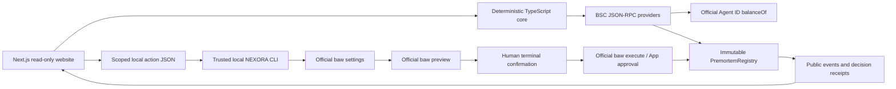

# Architecture

NEXORA anchors public action/evidence hashes and independent Agent ID reviewer decisions. It never executes the proposed transaction. A deterministic preflight manifest and a community decision answer different questions: the first records RPC observations and explicit heuristics; the second records opinions from eligible accounts.

`apps/web` contains the responsive App Router experience. Public pages render without wallet access. Protocol state comes from configured RPC calls and contract logs. Unconfigured deployment is an explicit state; it must never point at a guessed address. Browser EIP-1193 support is limited to the user's actual injected wallet and is not represented as Agentic Wallet connectivity.

`packages/core` holds strict schemas, canonical hashing, selector decoding, deterministic findings, RPC clients, bounded event scanning and receipt verification. Inputs remain exact integer wei and byte strings. Hashing binds chain ID, protocol address, creator, target, value, calldata hash, salt, block number/hash and protocol version. Reviewer commitments bind the chain, protocol, capsule, reviewer, verdict, confidence, evidence digest, category and secret salt.

`packages/contracts` has one immutable nonpayable registry, no owner or proxy. Holder actions use a read-only gas-bounded static call to the immutable identity contract. No write loops over reviewer arrays; totals update in constant time. Evidence authorship is event-backed. Finalization is permissionless after the room closes and does not count an eligible user unless that account also performed a holder-gated action.

`packages/cli` restricts writes to six protocol methods, encodes typed calldata, checks the actual official identity registry, simulates, previews through official local tooling and requires explicit human confirmation. No backend receives wallet credentials. `packages/agent-skill` documents the trust boundary for agent runtimes.

There is no required database, API account, AI model or pinning provider. Long evidence and reveal secrets remain local unless the user chooses to publish them. A hash establishes integrity of supplied bytes, not availability, accuracy, authorship of an unverified off-chain source, or future safety. A read-only RPC provider can still lie or omit data; the current client is not a consensus light client.
